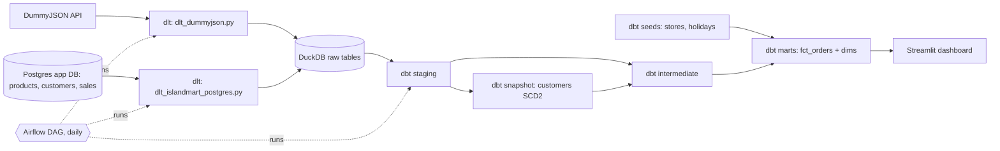
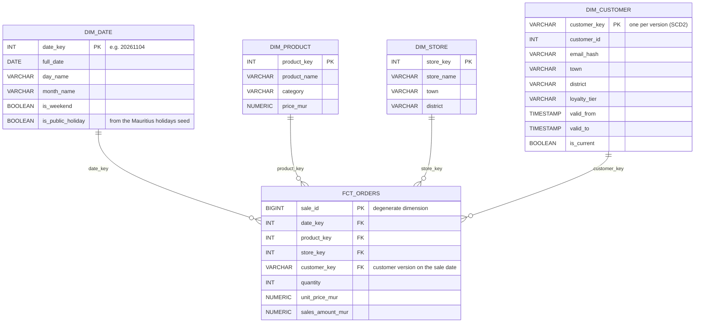

# IslandMart DB

IslandMart is a fictional goods shop in Mauritius, so this project was built to practise using Docker to run a database and connect multiple database GUIs to it. In this case, we have pgAdmin and DBeaver, both connected to one PostgreSQL database. It also loads and cleans data in the database using two of the 3 pipeline designs, which are ETL and ELT, and it uses Airflow to have everything automated.

## Stack
Postgres 17 and pgAdmin in Docker Compose, Python (pandas + SQLAlchemy + requests + pyarrow + PyYAML), dlt, dbt, DuckDB, uv.

## Architecture

## Quick start

1. Copy `.env.example` to `.env` and fill in the values
2. `uv sync`
3. `make up`, then run `sql/00_setup_sales.sql` and `sql/01_setup_customers.sql` in Postgres
4. `make all` (load with dlt, build and test with dbt)
5. `make dashboard`, then open http://localhost:8501
6. Optional, to schedule it: `make airflow-build`, `make airflow-up`, then turn on `islandmart_elt_daily` at http://localhost:8080

## Folder structure

    islandmart-db/
    ├── airflow/            Airflow 3: custom image (Dockerfile), DAG in dags/
    ├── contracts/          data contract for the supplier products
    ├── docs/               star schema diagram, Month 1 retrospective
    ├── islandmart_dbt/     dbt project: staging, intermediate, marts, snapshots, seeds, tests
    ├── python/             dlt pipelines, dashboard, Dagster, and earlier learning scripts
    ├── sql/                Postgres setup scripts and SQL practice
    ├── docker-compose.yml  IslandMart Postgres + pgAdmin
    └── Makefile            shortcuts (make help)

## Data quality and reliability
- dbt tests: unique, not_null, accepted_values, relationships, singular tests (amount = quantity x price, one current version per customer, raw vs staging row counts, valid quantities and prices), a unit test, and a warning for products never sold.
- Airflow: tasks run in order, 2 retries each, one run at a time (DuckDB allows one writer), and an alert written to `logs/airflow_alerts.log` when a task fails for good.
- Logging: the dlt pipelines write to `logs/pipeline.log`.

## Pipeline design: ETL (products CSV)
For loading the products CSV (`load_products.py`), the reason why I used ETL, instead of Zero-ETL or ELT, was because I was not planning in any way to use the data which I omitted. So, cleaning the data and having it in my database clean seemed more convenient for me.

## How to run
1. Copy `.env.example` to `.env` and fill in the values
2. `docker compose up -d`
3. `uv sync`
4. `uv run python/load_products.py`

## Cleaning results
59 rows read, 54 loaded: 1 row without an id dropped, 4 duplicates removed,
1 conflicting product_id flagged for review.

## What confused me
- The port 5432 clashed with my Windows PostgreSQL 18, and hence I had to change my port to another port that was not in use.
- Before, I didn't understand why pgAdmin uses `db`, but DBeaver uses `localhost`, but I later
understood that it's because DBeaver is the one that is installed on the PC, while pgAdmin runs inside its own Docker container, so it reaches Postgres by the service name `db`.

## Supplier feed (API extract)

A new file called `fetch_supplier_products.py` was created to help in fetching, and creating the JSON files to keep the data in segments.

I have added a retry function to ensure that if an error code which is retryable happens, instead of crashing it tries again, until it either succeeds or reaches the maximum number of tries. If the error code is not retryable (like 404), it stops straight away.

How to run: `uv run python/fetch_supplier_products.py`

## What I learned in SQL

I used an SQL Lab artifact, which allowed me to learn SQL for Data Engineers. I practiced using window functions like ROW_NUMBER, RANK vs. DENSE_RANK, etc. 

I learned the necessity of using upserts; they are needed in case a person needs to update information in a row, or add new data if it doesn't exist, while ensuring no duplicates are made mistakenly. 

I also learned the usage of indexes. Indexes allow a system to make queries with a lower execution time because, when there is no index, the computer is forced to do a sequential scan, which is a complete scan of the rows present.

## CSV vs Parquet

`compare_formats.py` exports the sales table from Postgres and saves the same data as CSV and as Parquet, then compares file size, read speed and data types.

| Format | Size |
|---|---|
| CSV | 5.54 MB |
| Parquet (snappy) | 1.68 MB (3.3x smaller) |
| Parquet (zstd) | 1.06 MB |

Parquet also kept the column types (like dates), while the CSV came back with dates as plain text. Parquet can also read only the columns I need, which makes it faster.

How to run: `uv run python/compare_formats.py`

## Analytics with DuckDB

`duckdb_analytics.py` uses DuckDB to run SQL directly on the Parquet, CSV and JSON files, without a database server. It joins sales and products, ranks categories by revenue with a window function, reads all the supplier JSON pages at once, and saves a monthly revenue table as a new Parquet file.

I asked the same question (revenue per product) three ways:

| Tool | Time |
|---|---|
| DuckDB on Parquet | 4.8 ms |
| pandas | 14.7 ms |
| Postgres | 25.7 ms |

DuckDB is made for analytics (OLAP), while Postgres is made for an app's day-to-day reads and writes (OLTP), so I'll keep using both for different jobs.

How to run: `uv run python/duckdb_analytics.py` (run `compare_formats.py` first, since it creates the Parquet file)

## Star schema

I designed a star schema for IslandMart's sales: one fact table (fct_orders) and four dimensions (date, product, store and customer, where customer keeps its history with SCD Type 2). See [docs/star_schema.md](docs/star_schema.md).

## ETL vs ELT (same supplier data, loaded twice)

I loaded the same 194 supplier products two ways:
- `python/etl_supplier_products.py`: cleaned in Python with pandas, following the rules in `contracts/supplier_products.yaml`, then loaded only the clean table.
- `python/elt_supplier_products.py`: loaded every product as raw JSON (JSONB) into `raw.supplier_products`, then cleaned it with SQL in `sql/elt_supplier_products.sql`.

Both gave 194 rows, and comparing them with `EXCEPT` found 0 differences.

| | ETL | ELT |
|---|---|---|
| Time (194 rows) | 0.22 s | 0.14 s |
| Where the cleaning lives | Python + data contract | SQL |
| Raw data kept? | No (16 of 27 columns dropped) | Yes, every field |
| Re-clean without calling the API? | No | Yes, rerun the SQL |
| Privacy | Sensitive fields never stored | Everything is stored first |

What I noticed:
- The ELT pipeline looked faster than the ETL, but I have done some research and found that ETL can be faster when one only needs a small part of the data, because less data is moved and stored. With only 194 rows, most of the time here is fixed overhead.

When I'd pick each one:
- ETL when the data has sensitive fields (like phone numbers) that should never be stored, or when I know exactly which columns I need.
- ELT when I want to keep everything and might want to clean it differently later.

How to run: `uv run python/etl_supplier_products.py` and `uv run python/elt_supplier_products.py`

## Incremental loader (watermark)

`python/incremental_supplier_products.py` only loads products whose `updatedAt` is newer than the last successful run. The bookmark (watermark) is saved in the `etl_watermarks` table, and it only moves forward after the load succeeds, in the same transaction. Loading uses upserts, so re-runs and backfills never create duplicates.

The table and the upsert are built from `contracts/supplier_products.yaml`, so adding a column to the contract is enough; the Python code doesn't change.

| Test | Result |
|---|---|
| First run | 194 rows loaded |
| Second run | 0 rows (nothing new) |
| One product changed | 1 row upserted, still 194 rows |
| Backfill from 2026-08-01 | rows reloaded, 0 duplicates, watermark not moved back |

How to run:
- `uv run python/incremental_supplier_products.py`
- `uv run python/incremental_supplier_products.py --since 2026-08-01` (backfill)
- `uv run python/incremental_supplier_products.py --show-sql` (see the SQL built from the contract)

## dlt + dbt (DummyJSON -> DuckDB -> clean views)

For this part, I was learning how to do the ELT work fast and efficiently. It's through using the dbt and dlt libraries, which save data to your database. In this case I was using DuckDB.

I have learned that dlt does the E and L (extraction and loading), while dbt does the transforming and makes your data into clean views. Hence, at the end I used DBeaver to see my cleaned data, without writing Python files to clean the data.

I have learned the importance of using those libraries instead of writing the extraction, loading and transformation Python files myself. They do them automatically by themselves, and as the programmer, all I am left with is deciding the configuration and where the data goes. Without forgetting that I write the SQL files as well, but the remaining tasks are done by those libraries.

Even though I had one source and a few tables, I learned that dbt and dlt are mostly useful when one is working on very big projects, like fetching data from many sources and having thousands of tables.

How to run:
- `uv run python/dlt_dummyjson.py`
- `cd islandmart_dbt` then `dbt build`

## Star schema in dbt (staging -> intermediate -> marts)

Previously, I had created a Lucidchart diagram showing the star schema, which is one of the most efficient and easy ways for data users (e.g. data analysts and scientists) to query transformed data.

Hence, I have now implemented the star schema in dbt, and I have learned that for ELT pipelines, the best way to implement dbt is following a certain pattern, which is staging, to intermediate, and lastly marts (the star schema in my database).

### Where the data comes from
- `sql/01_setup_customers.sql` adds 500 customers (Mauritian towns and districts) to Postgres and links every sale to a customer and a store.
- `python/dlt_islandmart_postgres.py` loads products, customers and sales from Postgres into DuckDB (`raw_islandmart`) with dlt: products are replaced, customers are loaded incrementally on `updated_at` and merged, sales are loaded incrementally on `sale_id` and appended. `--refresh` rebuilds everything from scratch.
- Seeds: `stores.csv` (5 stores) and `mauritius_public_holidays_2026.csv`.

### Layers
| Layer | Models | What it does |
|---|---|---|
| Staging | `stg_islandmart__products`, `stg_islandmart__sales`, `stg_islandmart__customers` | This part is in charge of the general clean-up, like fixing data types, renaming columns, removing the duplicate product, and removing or hashing personal data. |
| Snapshot | `customers_snapshot` | This allows the company not to lose important information when, for instance, a client's data changes (e.g. location). A new row is added only when the client's details change, and the old rows are kept as history, to be used when needed. |
| Intermediate | `int_sales_with_customer_versions` | Here is where some business logic starts to come in, e.g. matching sales with their customers. |
| Marts | `fct_orders`, `dim_date`, `dim_product`, `dim_customer`, `dim_store` | This is the last part, which organises the data into dimensions and a fact table to make querying the data easier. |

Grain of `fct_orders`: one row per product line in a sale.

### SCD Type 2 (customer history)
While building the star schema in dbt, I wanted to see what happens when a client changes location. Because I had added snapshots, both the data before and after relocating were kept: customer 42's sales before 1 June 2026 still count under Curepipe, and the ones after count under Grand Baie.

### Tests
- Generic tests: `unique`, `not_null`, `accepted_values`, `relationships` (every key in `fct_orders` exists in its dimension).
- Singular tests: amount = quantity x price, and exactly one current version per customer.
- Unit test: staging keeps the most recently updated row when a product appears twice.

The reason tests were added to this project is to make it easy to catch mistakes, so a data engineer can see when the rules they set are broken much faster, before bad data reaches the marts.

### How to run
1. `docker compose up -d`
2. Run `sql/00_setup_sales.sql`, then `sql/01_setup_customers.sql` in Postgres
3. `uv run python/dlt_islandmart_postgres.py`
4. `cd islandmart_dbt`, then `dbt seed` and `dbt build`
5. `dbt docs generate` and `dbt docs serve` to see the lineage

## Data model

Below, I have represented what the star schema looks like. This is done to help the users of the data, like analysts, to query it more easily and faster.

- **Grain of `fct_orders`:** one row per product line in a sale.
- **Keys:** products, stores and dates use their own IDs as keys. Customers use a surrogate key (one per version), because a customer can have several versions.
- **Incremental:** `fct_orders` only adds sales with a `sale_id` higher than the last one loaded, so a daily run doesn't rebuild 200,000+ rows.
- **Macro:** `date_key()` builds the date key the same way in `dim_date` and `fct_orders`.

### NB
- Inside the `fct_orders` table, I used an incremental model, but not in my dimension tables. This is because the fact table is big and keeps growing, since new sales are added constantly, while the dimension tables are small and quick to rebuild. Changes in customers' details are handled by the snapshot instead.

  Hence, to minimise the processing time, the incremental model only loads information that hadn't been loaded before.

- Another important change I added is the macro for `date_key`. The reason is to avoid rewriting the same code that turns dates into numbers.

## Orchestration: Airflow vs Dagster

I scheduled the same IslandMart pipeline with both tools:
- Airflow: `airflow/dags/islandmart_elt_daily.py` runs the dlt and dbt pipeline daily in Docker (official docker-compose, Airflow 3.3.2).
- Dagster: `python/dagster_defs.py` runs dlt and dbt as assets (`dagster-dlt` + `dagster-dbt`).

What I noticed:
1. Running Dagster was faster than Airflow, and the reason is that Dagster is lighter compared to Airflow. In my setup, it doesn't need Docker; it runs locally on my PC, and it runs the dlt and dbt work automatically, because it reads my dlt source and dbt project by itself.
2. I also learned that Airflow is better as a scheduler of anything, beyond dealing with data, while Dagster is designed mainly for data.
3. I also learned that Airflow doesn't run directly on Windows, so I ran it with Docker, while Dagster ran straight from my project.

In conclusion, I'd go with Dagster if all I wanted to schedule/automate were data jobs, but use Airflow when I want to be able to schedule other things too.

How to run:
- Airflow: `cd airflow`, `docker compose up -d`, then trigger `islandmart_elt_daily` at http://localhost:8080
- Dagster: `uv run dagster dev -f python/dagster_defs.py`, then open http://localhost:3000

## Mini-project 1: end-to-end ELT pipeline

At the end, I was able to finish my first data engineering project with IslandMart DB, which fetches data saved in Postgres and from the DummyJSON API, and uses Airflow to automate the whole pipeline. That is, Airflow is the scheduler I have added, so that the extraction, loading and transformation (staging, intermediate and marts) are done automatically at a set time, and the dashboard (Streamlit) always shows the fresh data.

It's also important to note that I set it up in a way that if an error happens (i.e. a process fails), the task is retried twice, and if it still fails, the next steps don't run. Instead, it reports which task failed, and the specific error can be found in that task's log.

Below are the processes that are now happening automatically:

    Airflow DAG islandmart_elt_daily (daily)
      load_dummyjson_api -> load_postgres_to_duckdb -> dbt_build -> dbt_test
      Streamlit dashboard reads the marts from warehouse/islandmart.duckdb

- `airflow/dags/islandmart_elt_daily.py`: 4 tasks in order, 2 retries each, and an alert when a task fails for good (written to the task log and `logs/airflow_alerts.log`).
- `airflow/Dockerfile` + `airflow/requirements.txt`: Airflow runs from a custom Docker image with dlt and dbt pre-installed, instead of installing packages at every start.
- `python/dashboard.py`: Streamlit dashboard with revenue, revenue per month, revenue by district, holidays vs normal days, and the top 10 products.

How to run:
1. `docker compose up -d` (IslandMart Postgres)
2. `cd airflow`, `docker compose build` (first time only), `docker compose up -d`, then trigger `islandmart_elt_daily` at http://localhost:8080
3. `uv run streamlit run python/dashboard.py`, then open http://localhost:8501