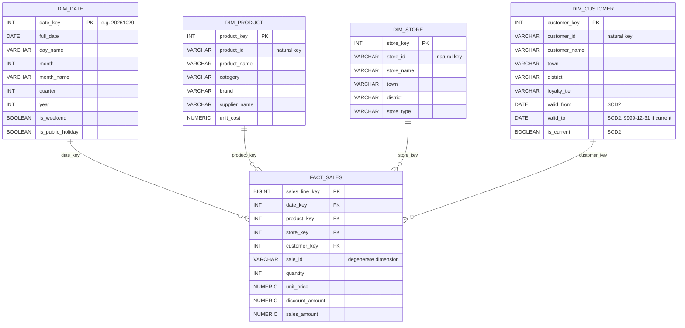
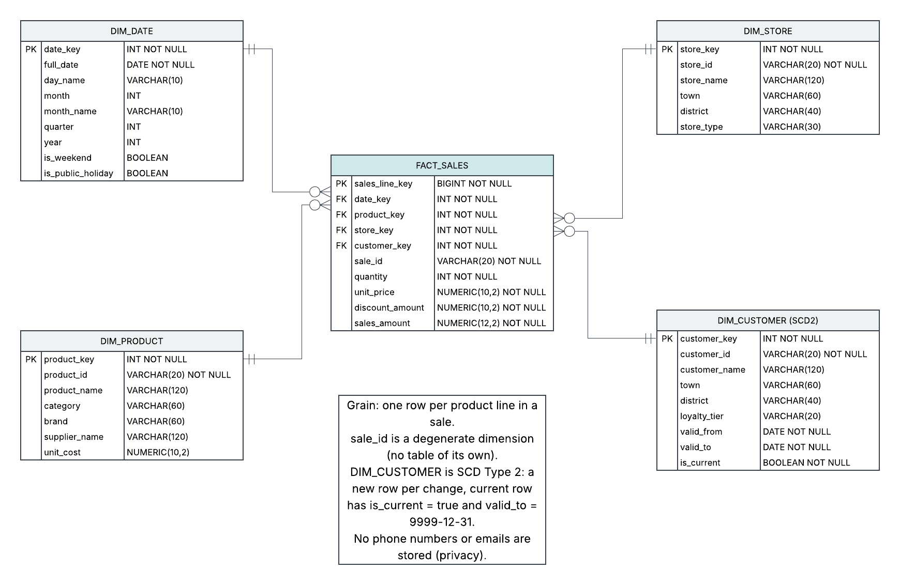

# IslandMart Star Schema

Grain: one row per product line in a sale.

## Notes
- `sale_id` is a degenerate dimension: no table of its own.
- DIM_CUSTOMER is SCD Type 2: a new row per change, so old sales keep the town the customer lived in at the time.
- No phone numbers or emails are stored (privacy).

